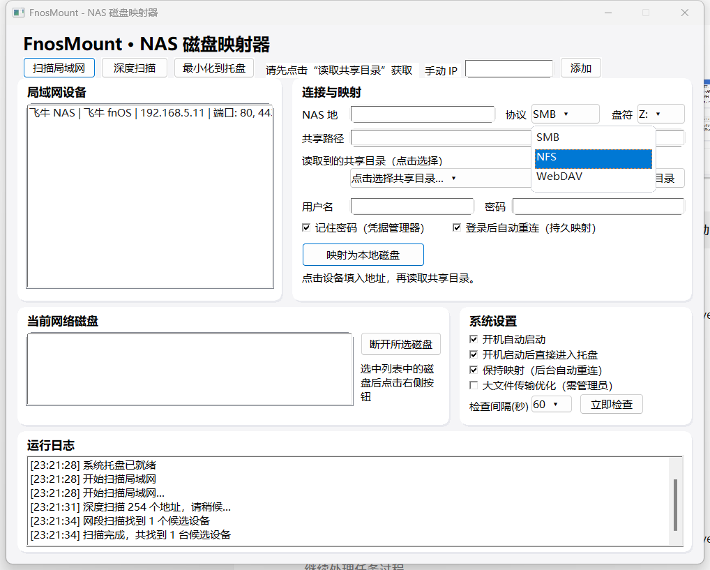

# NAS 磁盘映射器（FnosMount）

零第三方依赖的 **Windows 原生 GUI 程序**（不使用网页/浏览器），自动搜索局域网中的 **飞牛 / 群晖 / 威联通 NAS**，把共享文件夹挂载为本地磁盘（Z:、Y: 等）。可直接运行打包好的 exe，无需安装 Python。



## 功能

- **苹果风格原生界面**：浅灰背景 + 白色圆角卡片、蓝色分组标题，按钮为系统标准按钮（中文清晰、黑色文字与浅底高对比），主按钮带蓝色高亮边框、点击有系统按下反馈；双击 exe 直接展示主页，支持最小化到系统托盘。
- **可见的下拉选择框**：协议 / 盘符 / 检查间隔 / 共享目录均为自绘圆角下拉列表（弹窗 + 列表控件），点击展开后选项清晰可见、超过 9 项自动出现滚动条；鼠标划过的选项显示蓝色底色，松开鼠标才确认；点击别处或按 ESC 收起。共享目录下拉框右侧紧邻「读取共享目录」按钮。
- **悬停动画**：鼠标移到按钮/下拉框上时，外围会渐显一圈蓝色高亮描边（约 200ms 淡入、130ms 淡出，描边由外向内收拢），配合系统自身的按键悬浮底色；禁用状态的按钮不触发。
- **运行日志**：底部日志卡片随窗口高度自适应、铺满整行，始终自动滚动到最新一行，异常也会写入日志便于排查。
- **多品牌自动发现**：飞牛 fnOS、群晖 DSM、威联通 QTS。mDNS/DNS-SD、SSDP/UPnP、WS-Discovery 并行探测；组播不可用时自动回退网段端口扫描 + Web 指纹识别。
- **共享目录枚举**：读取 NAS 的 SMB 共享列表（支持中文共享名），以下拉选框展示，选中即填入路径，也可手动输入。
- **单实例运行**：重复双击 exe 不会开出第二个窗口，而是把已运行的窗口还原并激活到前台。
- **三种挂载协议**：SMB、NFS（Windows NFS 客户端）、WebDAV（WebClient），均映射为真实盘符。
- **持久化映射**：勾选“登录后自动重连”生成持久映射；后台看护线程定期检查并在 NAS 重启/网络波动后自动恢复。
- **开机自启动**：界面开关写 HKCU Run 项；或管理员运行 `install-autostart.bat` 创建计划任务；均在托盘启动并恢复磁盘。
- **大文件传输优化**：可开关的 SMB 客户端并发参数 + NFS 128KB 读写块，关闭时自动恢复原值。
- **凭据安全**：密码保存在 Windows 凭据管理器（DPAPI），配置文件不写明文。

## 快速开始

### 方式一：直接运行 exe（推荐）

双击 `dist\FnosMount.exe`，打开原生窗口；关闭按钮只是隐藏到托盘，右键托盘图标选择“退出程序”才真正退出。

```bat
dist\FnosMount.exe --tray           :: 启动后直接驻留托盘，不显示窗口
dist\FnosMount.exe --reconnect      :: 恢复已保存的映射后显示窗口
dist\FnosMount.exe --selftest       :: 命令行自检（调试用）
```

### 方式二：运行源码

双击 `run.bat`（需要 Python 3.8+ 并加入 PATH）。

### 界面操作流程

主窗口为单窗口分区布局：

1. 点「扫描局域网」或「深度扫描」，左侧“局域网设备”列表显示品牌、名称、IP、端口；点击设备填入 NAS 地址。也可在顶部“手动 IP”输入地址后点「添加」。
2. 点下拉框右侧的「读取共享目录」，共享项会填入“读取到的共享目录”下拉框，点击下拉框选择即填入共享路径，也可直接手动输入。
3. 选择协议（SMB/NFS/WebDAV）和盘符，填写用户名/密码（允许匿名可留空）。
4. 点「映射为本地磁盘」；成功后出现在下方“当前网络磁盘”列表。
5. **断开磁盘**：在“当前网络磁盘”列表选中一项，点击列表右侧的「断开所选磁盘」按钮。
6. 右侧“系统设置”可开关开机自启、开机静默进托盘、映射看护和传输优化；底部为运行日志（自动滚到最新）。

## 系统设置

「设置」按钮显示当前开机自启、映射看护和大文件优化状态。全局选项位于 `%APPDATA%\FnosMount\config.json`：

| 配置项 | 说明 |
| --- | --- |
| autostart | 当前用户 Run 项，登录后在托盘运行并恢复映射 |
| start_minimized | 仅对开机自启生效：勾选时登录后静默进托盘；手动双击 exe 始终展示主页 |
| keep_mounted | 默认开启；后台按间隔检查并恢复断线的持久映射 |
| large_file_tuning | SMB `DisableBandwidthThrottling` / `MaxCmds` + NFS `rsize=131072,wsize=131072`；需管理员权限 |
| watchdog_interval | 30/60/120/300 秒 |

传输优化原值备份在配置文件的 `tuning_backup` 字段，关闭时自动写回。

## 托盘菜单

- **打开界面**：显示主窗口
- **立即重连磁盘**：恢复所有配置为自动重连的映射
- **退出程序**：停止看护线程、移除托盘图标并退出

## 命令行与计划任务

```bat
python main.py --selftest    :: 自检并扫描局域网
python main.py --tray        :: 仅托盘运行
python main.py --reconnect   :: 恢复已保存映射
```

管理员运行 `install-autostart.bat` 创建 `FnosMountAutoReconnect` 登录任务；卸载用 `uninstall-autostart.bat`。脚本优先使用 `dist\FnosMount.exe`。

## 重新打包 exe

```bat
build.bat
```

等价于：

```bat
python -m PyInstaller --noconfirm --onefile --windowed --name FnosMount --icon "fnos_mount\assets\fnosmount.ico" --add-data "fnos_mount\assets;fnos_mount\assets" main.py
```

输出：`dist\FnosMount.exe`。

## 检测原理

| 阶段 | 实现 |
| --- | --- |
| 设备发现 | mDNS 查询 `_fnnas` / `_synology` / `_dsf` / `_qnap` 等服务；SSDP/UPnP；WS-Discovery |
| 兜底发现 | 扫描网段的 80/443/445/2049/5000/5001/5005/5006/5666/8080/8081 端口，抓取 Web 指纹识别品牌 |
| 品牌指纹 | 飞牛：fnnas / fnOS / 飞牛；群晖：Synology / DiskStation / 群晖；威联通：QNAP / QTS / 威联通 |
| 共享枚举 | `net view \\NAS`，解析中英文共享类型列 |
| SMB 挂载 | `WNetAddConnection2W`，支持持久映射、凭据、指定盘符 |
| NFS 挂载 | `mount.exe`，可附加 rsize/wsize |
| WebDAV 挂载 | `net use` + WebClient，自动检测 HTTP BasicAuthLevel |
| 界面与托盘 | 纯 Win32 API（ctypes）：原生窗口/控件 + `Shell_NotifyIconW` |

## 常见问题

**扫描不到设备？** 确认同一网段且未开启访客网络/AP 隔离；尝试深度扫描；或在“手动 IP”处添加。

**读取共享失败？** 填写 NAS 账号密码后再读取，或手动输入共享名。

**托盘图标没出现？** 程序通过 exe 或 Windows Python 运行时会创建托盘；`--tray` 模式下不显示窗口，双击托盘图标打开。

**映射总掉线？** 保持“保持映射”开启并调小检查间隔；NAS 重启后看护线程会自动重连。

**WebDAV / NFS 提示权限？** 点击界面对应的启用按钮，均需管理员权限。

## 安全说明

- 密码写入 Windows 凭据管理器，不出现在配置文件、命令行或日志中。
- HTTP WebDAV 基本认证会降低安全性，请仅在可信局域网使用。

## 目录结构

```
FnosMount/
├── main.py                    # 入口（窗口 / 自检 / 重连 / 托盘）
├── fnos_mount/
│   ├── native_ui.py           # 原生 Win32 GUI 与业务逻辑
│   ├── tray.py                # 系统托盘
│   ├── discovery.py           # 多品牌、多协议发现
│   ├── shares.py              # SMB 共享枚举
│   ├── mount.py               # SMB / NFS / WebDAV 挂载
│   ├── credentials.py         # 凭据管理器
│   ├── autostart.py           # 开机自启
│   ├── watchdog.py            # 映射看护
│   ├── performance.py         # 大文件传输优化
│   ├── config.py              # 配置持久化
│   └── assets/                # 图标
├── tests/test_core.py         # 单元测试（unittest，14 项）
├── docs/preview.png           # 界面截图
├── dist/FnosMount.exe         # 打包成品（不入库，用 Release 附件分发）
├── run.bat / build.bat        # 启动与打包
├── requirements.txt           # 仅打包用开发依赖（运行时零依赖）
├── CHANGELOG.md               # 更新记录
└── .gitignore / .gitattributes
```
